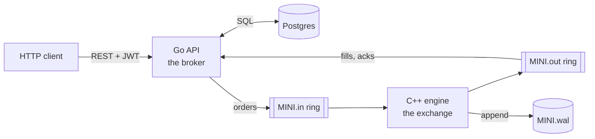

# mini_trading_platform

A small stock trading platform with its own exchange. A Go API acts as the broker: it handles accounts, cash, risk checks and Postgres. A C++ matching engine acts as the exchange. The two talk over lock-free ring buffers in shared memory.



Only stocks listed on our exchange can be traded. Right now that's one stock, `MINI`. Other stocks in the database are read-only, for prices and charts.

## Numbers

The order book alone handles about 14M operations per second on an Apple M5 (about 5M inside Docker), with a p50 latency of 42 ns and a p99 of about 250 ns. The benchmark runs 1M random limit orders and cancels around a price of 100. See [docs/engine.md](docs/engine.md#benchmark) for how it's measured and what it leaves out.

## Run it

You need Docker with at least 3 CPUs, because the engine is pinned to core 2.

```sh
cp .env.example .env     # set JWT_SECRET
docker compose up --build
```

The API is on http://localhost:8099. A short walkthrough:

```sh
API=http://localhost:8099

curl -s -X POST $API/v1/users -d '{"Email":"a@example.com","Password":"pw"}'
TOKEN=$(curl -s -X POST $API/v1/login -d '{"Email":"a@example.com","Password":"pw"}' | jq -r .Token)

MINI=$(curl -s "$API/v1/stocks?search=MINI" | jq -r '.Stocks[0].ID')

# Buy 10 MINI at $100.00 limit. Nobody is selling, so it rests on the book.
curl -s -X POST $API/v1/orders -H "Authorization: Bearer $TOKEN" \
  -d "{\"StockID\":\"$MINI\",\"Side\":\"buy\",\"Quantity\":\"10\",\"Price\":10000}"

curl -s $API/v1/cash -H "Authorization: Bearer $TOKEN"                  # 9900000: $1,000 of the $100,000 is reserved
curl -s -X DELETE $API/v1/orders/1 -H "Authorization: Bearer $TOKEN"    # cancel, refunds the reservation
```

The book starts empty, so a buy has nothing to fill against until someone sells. Market-maker bots that quote both sides are next on the [roadmap](docs/roadmap.md).

`docker compose down -v` wipes the database and the engine's logs. Wipe both together, because order ids come from Postgres and the engine replays its log on startup.

## Tests

```sh
cd engine && c++ -std=c++17 -g -fsanitize=address,undefined matching_engine.cpp -o me && ./me
cd engine && c++ -std=c++17 -O2 -DNDEBUG matching_engine.cpp -o me && ./me --bench
go test -race ./internal/...          # the trading tests skip unless DB_URL is set
```

## Layout

```
engine/              C++ matching engine, ring buffer, wire protocol
internal/exchange/   Go side of the rings: Dial, Submit, Cancel
internal/trading/    orders, reservations, fills, portfolio
internal/api/        HTTP handlers and routes
internal/users/      signup, login, refresh tokens
internal/market/     stocks and price bars (read-only)
sql/schema/          goose migrations
sql/queries/         sqlc queries (generated code in internal/database/)
```

## Docs

- [Architecture](docs/architecture.md): broker vs exchange, the life of an order
- [Engine](docs/engine.md): order book, ring buffer, protocol, pinning
- [Recovery](docs/recovery.md): write-ahead log, restarts, known gaps
- [API](docs/api.md): endpoints and errors
- [Roadmap](docs/roadmap.md): what's planned
