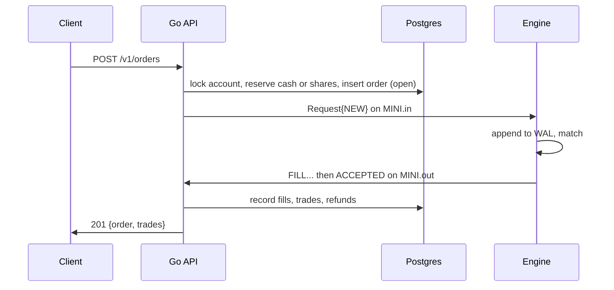

# Architecture

The platform splits like a real market. The Go API is the broker and the C++ engine is the exchange.

| | Broker (Go, `internal/`) | Exchange (C++, `engine/`) |
|---|---|---|
| Knows about | users, cash, positions, order history | one order book per stock |
| Stores data in | Postgres | an append-only log per stock |
| Decides | whether a user can afford an order | which orders trade, and at what price |

The engine never sees a user or a dollar balance. It gets an order id, a side (buy/sell), a price and a quantity, and it answers with fills. Every risk check happens in Go before the order reaches the engine.

## Life of an order

1. Go checks the input and locks the user's account row.
2. A buy reserves `limit × qty` in cash. A sell checks that the user's position, minus shares already in open sells, covers the quantity.
3. Go inserts the order as `open`. Its `BIGSERIAL` id becomes the engine's order id.
4. Go pushes a 32-byte request onto the stock's inbound ring.
5. The engine logs the request, matches it, and pushes zero or more `FILL` events, then one final event: `ACCEPTED` (with the quantity left on the book), `CANCELED` or `REJECTED`.
6. Go writes the fills in one transaction. Each fill creates a trade for both the buyer and the seller. A buy that filled below its limit gets the difference back.

A cancel follows the same path. The engine answers `CANCELED` with the quantity it removed, and Go refunds `limit × removed` for a buy. If the order filled first, the engine answers `REJECTED` and the API returns 409.

## Concurrency

On the engine side, each stock runs on its own thread with its own book and its own pair of rings. The book has no locks, because only one thread touches it.

On the Go side, each stock has one writer goroutine and one reader goroutine, so each ring has exactly one producer and one consumer. Answers come back in request order. Go matches them to requests through a FIFO channel and needs no ids in the reply path.

HTTP handlers run concurrently. Two things keep them correct:

- A per-user `SELECT ... FOR UPDATE` on the account row serializes one user's orders, so two sells can't both spend the same shares.
- A global mutex serializes writing engine answers to Postgres. That keeps lock order simple between a buyer's and a seller's accounts. It caps throughput at one apply at a time, and a per-stock lock is the upgrade path.

Engine calls use `context.WithoutCancel` with a 5 second timeout. Once an order reaches the engine, Go finishes recording the answer even if the HTTP client disconnects.

## Design choices

**Shared memory instead of TCP or gRPC.** The broker and the exchange run on the same machine, so a ring in shared memory skips the kernel on every message. A push or pop is a few loads and stores.

**C++ for the engine.** The engine controls its memory layout and has no garbage collector pausing the matching thread.

**Reserving cash up front.** The engine can fill an order at any moment after Go sends it. Reserving first means a fill can never overdraw an account.

**Whole shares on our exchange.** The protocol carries quantity in 1e-8 shares to match `NUMERIC(20,8)` in Postgres, but the API accepts whole shares only. Fractional orders need rules for rounding cash, which can wait.

**Rings on a tmpfs volume, not `/dev/shm`.** Under Docker Compose, a restarted engine container gets a fresh `/dev/shm`, and the API would keep reading the old one. A named tmpfs volume stays mounted in both containers, so the API sees the new ring files.
